<div align="center">

# Vantage

**Open-source space-domain awareness on a live 3D globe.**

Every tracked object in orbit, collision probability checked against NASA's own reference cases, and the world underneath it:
aircraft, ships, earthquakes, fires, storms, front lines and conflict history since 1989, 175,000 pieces of infrastructure, 193,000 public cameras, the aurora, the night sky overhead, and every mountain with its summit forecast. Click anything and it tells you what it is.

**[Open the live demo](https://jdardash.github.io/vantage/)** &nbsp;|&nbsp; [Quick start](#quick-start) &nbsp;|&nbsp; [Gallery](#gallery) &nbsp;|&nbsp; [How it compares](#how-it-compares) &nbsp;|&nbsp; [API](#api-reference)

[](https://github.com/jdardash/vantage/actions)
[](https://codecov.io/gh/jdardash/vantage)
[](https://python.org)
[](#validation--accuracy)
[](https://cesium.com/platform/cesiumjs/)
[](LICENSE)

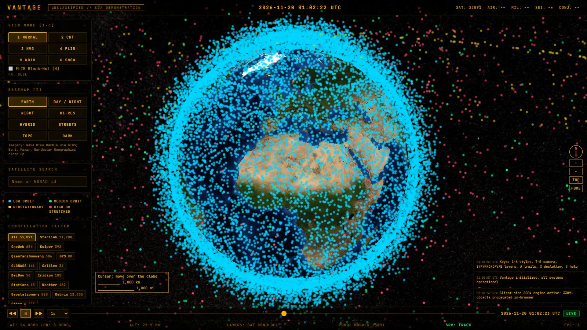

</div>

The live demo is the globe running entirely in the browser on a fixed element snapshot, with client-side SGP4 and no backend. Positions in it are illustrative, since SGP4 accuracy degrades within a couple of weeks of epoch. Run the full application (`python -m sda.api`, or `make docker`) for current elements and everything that needs a server: conjunction screening, collision probability, the camera catalog, live feeds, space weather and summit conditions.

## Gallery

| | |
| --- | --- |
| 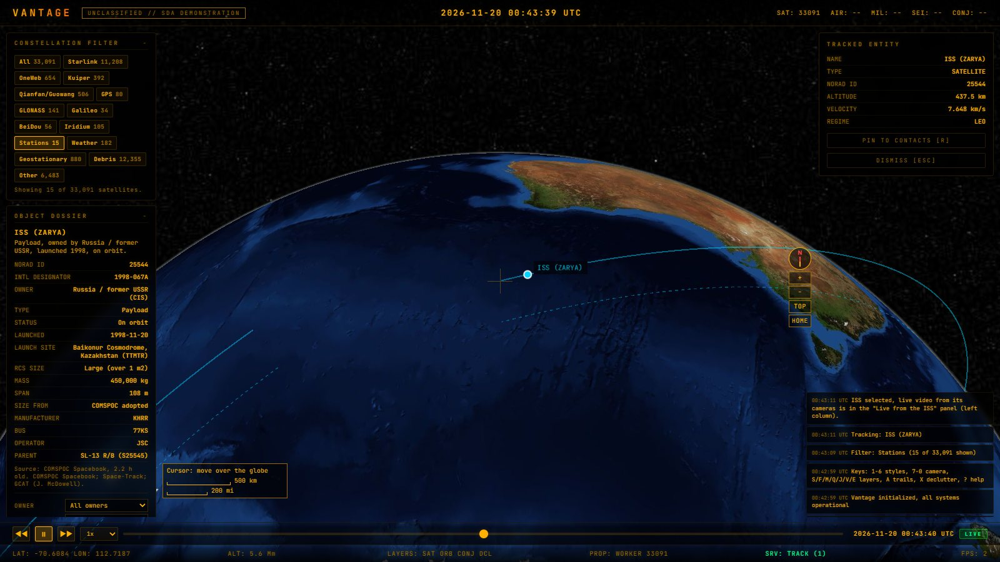 | 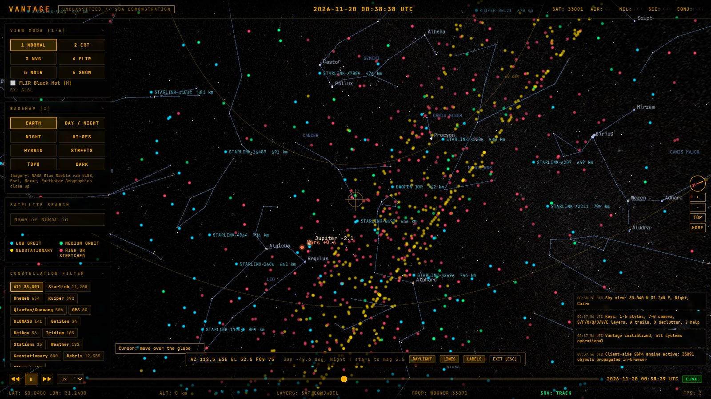 |
| **Object dossier.** The ISS picked from the stations filter, with owner, launch, size and mass from the public SATCAT. | **Sky view.** Standing in Cairo looking up: 2,851 stars, constellation lines, the planets and every satellite above the horizon. |
| 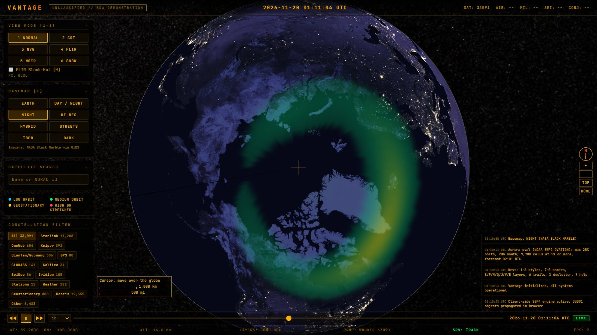 | 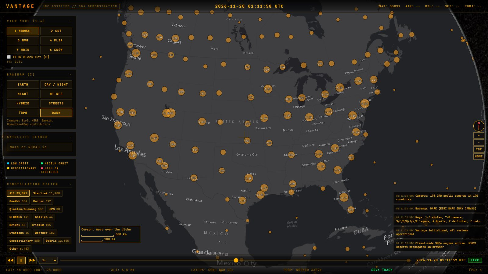 |
| **Aurora.** NOAA SWPC's OVATION oval over the Black Marble night lights. | **Public cameras.** 193,190 public cameras across 176 countries, clustered until you zoom in. |
| 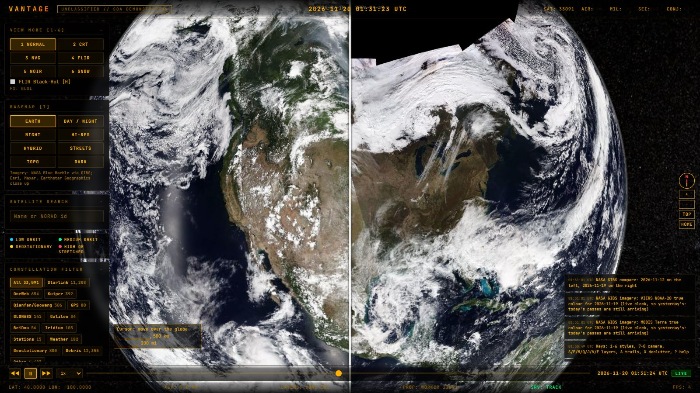 | 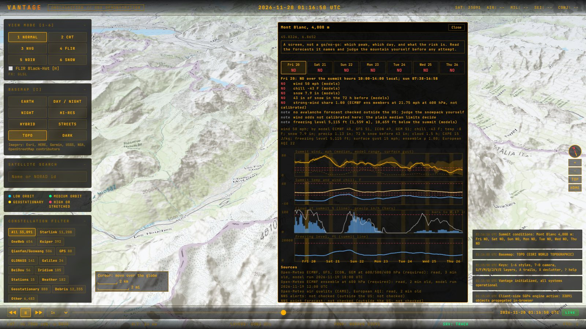 |
| **NASA imagery.** VIIRS true colour for any day since 2018, swiped against July. | **Summit conditions.** Mont Blanc on 3D terrain with a seven-day GO / MARGINAL / NO call. |
| 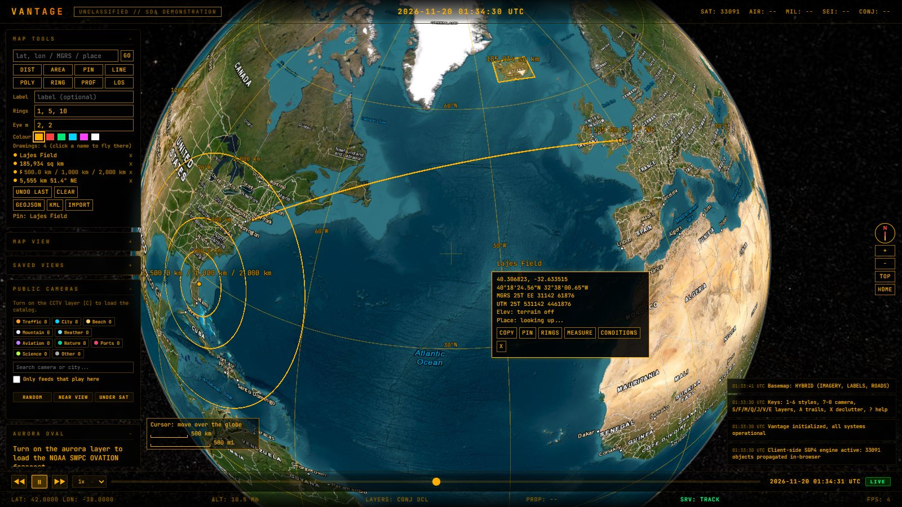 | 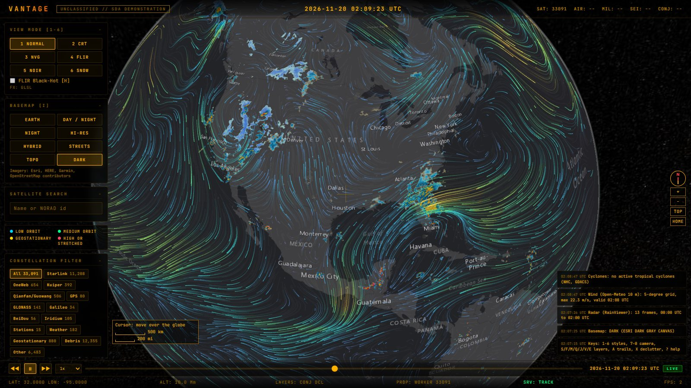 |
| **Map tools.** A JFK to Heathrow great circle, range rings, an area, a pin, the graticule and a coordinate card with MGRS and UTM. | **Weather.** RainViewer radar under an Open-Meteo 10 m wind field, with NHC and GDACS cyclones when any are active. |
| 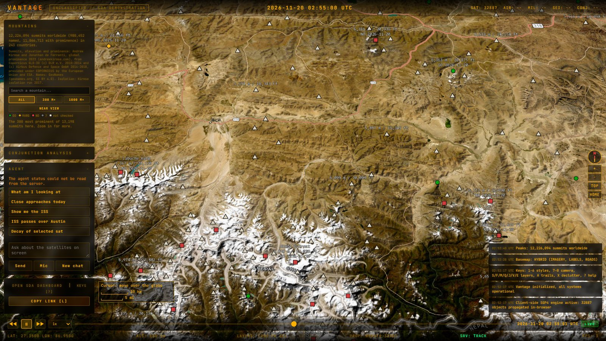 | 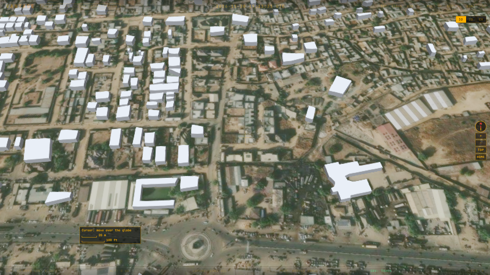 |
| **World peaks.** The Khumbu with every summit over 100 m of prominence; markers carry each peak's GO / MARGINAL / NO call for the day. | **3D city.** Kano from 465 m with no map key: 2,174 OpenStreetMap buildings extruded from their tags over Esri imagery. A free Cesium ion token swaps in Google's photorealistic mesh. |

## How it compares

Checked on 2026-11-19 against the public sites and the open-source projects surveyed in [reference/COMPARISON.md](reference/COMPARISON.md) (section 10 has the method and the evidence). Paid and closed products are compared from their own public material.

| | Vantage | NASA Worldview / Eyes | CelesTrak SOCRATES | keeptrack.space | Paid SSA (LeoLabs, Slingshot, COMSPOC) |
| --- | --- | --- | --- | --- | --- |
| Full public catalog live in 3D | yes, worker SGP4, 33,000 objects | dozens of NASA missions | no globe | yes | yes |
| Collision probability methods | Foster, Chan, Alfano, Monte Carlo, with usage checks | none | one | not in the public build | yes, on their own covariances |
| Checked against NASA CARA reference cases | 53 of 53 CDMs, 11 of 11 Alfano cases, in CI | n/a | no | no | not published |
| CCSDS CDM in and out (KVN and XML) | yes | no | download only | no | yes |
| Survives the primary catalog going down | yes: SatNOGS DB and COMSPOC Spacebook fallbacks, six-digit ids | n/a | n/a | no | own sensors |
| Dated satellite imagery and natural events | NASA GIBS with swipe compare, EONET | yes, the reference | no | no | no |
| Public cameras on the map | 193,190 (167,883 playable) | no | no | no | no |
| Aurora, space weather, sky view | OVATION oval, Kp and solar wind, stars and planets from any point | partial | no | partial | no |
| Weather and map tools | radar, animated wind, cyclones; distance, area, rings, profile, line of sight, MGRS and UTM | weather imagery layers; distance and area measuring | no | no | no |
| Mountains with summit forecasts | 12.2 million summits, a GO / MARGINAL / NO call per day | no | no | no | no |
| Assistant with typed tools | local model by default, plus MCP | no | no | no | AIP-style, paid |
| Price and source | free, MIT | free, closed app | free | free, AGPL | paid, closed |

Against the OSINT world maps, checked the same day. ARGOS ATLAS is closed and freemium, so it is compared from its public feature list; the VIP layer it has (people linked to private jets and yachts) is left out of Vantage on purpose, as person tracking.

| | Vantage | ARGOS ATLAS |
| --- | --- | --- |
| Price and source | free, MIT, 3D globe included | 2D map free, 3D globe paid, closed |
| Public cameras | 193,190 (167,883 playable) | 200,000+ (18,838 live video) |
| Military aircraft, emergency squawks, sanctions match, dead reckoning | yes, plus GPS interference hexes | yes |
| Ships: AIS, dark ships, sanctions by IMO, strait monitors | yes, nine chokepoints, OFAC and UK lists | yes, OFAC |
| Front lines | Ukraine drawn daily since 2022-04-03; 13 more theatres as towns held | 16 drawn |
| Verified events and conflict history | GeoConfirmed; UCDP, 434,601 events since 1989 | GeoConfirmed; UCDP |
| Country cards, outbreaks, cyber, outages, convergence | yes | yes |
| Infrastructure | 174,861 sites and cables | about 93,000 sites and cables |
| Satellites, collision probability, sky view, aurora, summits, NASA imagery | yes | not on its feature list |

What Vantage cannot match is the data the paid products own: their radars and telescopes, orbit determination from raw observations, and operator ephemerides. A free tool downstream of public elements never has better states than its sources, and the [disclaimer](#disclaimer) applies.

---

## What It Does

Ingests **Two-Line Element sets (TLEs)** from CelesTrak, propagates orbits with **SGP4**, screens all satellite pairs for close approaches, computes collision probability with TLE-age-scaled covariance, and generates avoidance maneuver options, all served over a FastAPI REST/WebSocket API with a built-in 3D dashboard.

| Feature | Description |
| ------- | ----------- |
| **SGP4 Propagation** | WGS72 gravity model, ECI (TEME) frame, vectorized NumPy batch mode |
| **Two-Phase Conjunction Detection** | Coarse screen (60 s steps) then fine refinement (1 s steps) around candidate TCAs |
| **Full-Catalog Screening** | Apogee/perigee shell prefilter, per-step spatial index (scipy KD-tree or a numpy grid hash), vectorized `SatrecArray` propagation; 5,000 objects in 2.9 s, identical candidate set to all-pairs |
| **Regime Survey and Exclusions** | LEO / MEO / GEO / HEO surveys with per-regime thresholds, formation-flying exclusion table (ISS, CSS, TanDEM-X, Starlink and OneWeb same-launch), composite 0-100 risk score |
| **Collision Probability (Pc)** | Foster 2D quadrature, Chan series, Alfano erf-strip series and Monte Carlo over real 3x3 covariances; TLE-age-scaled sigma when no covariance exists |
| **Pc Usage Checks** | Eight coded warnings (slow encounters, extended encounters, NPD or ill-conditioned covariance, Chan aspect limit, HBR near miss, dilution); CARA-style covariance remediation and realism scaling; maximum Pc with a missing covariance (Frisbee) and the dilution maximum |
| **NASA CARA Validation** | `python -m sda.cara` reruns 53 NASA CARA CDMs and the 11 Alfano 2009 test cases against every method; a CI job |
| **Risk Classification** | Five-level assessment: CRITICAL / HIGH / MODERATE / LOW / NEGLIGIBLE |
| **Maneuver Planning** | Along-track, cross-track, and radial delta-V options per lead time |
| **Monte Carlo Analysis** | Gaussian position-noise miss-distance distributions; cross-check for the analytic Pc |
| **Orbital Decay Estimation** | Harris-Priester-style atmospheric model with F10.7 solar-flux scaling |
| **CCSDS CDM Exchange** | Conjunction Data Messages per CCSDS 508.0-B-1: KVN and XML readers, KVN writer with the Pc method stated, Pc recomputed from the message covariances |
| **Pass Prediction and Sensors** | Observer look angles (azimuth, elevation, range, range-rate), rise / max / set passes with sunlit and shadow flags, a bundled sensor network with field-of-view coverage, geofences and DOP |
| **Breakup and Re-entry** | NASA Standard Breakup Model (EVOLVE 4.0) fragment clouds with Gabbard data and a collision-consequence summary; fragments fitted to TLEs so the cloud screens like any other object; re-entry watch list |
| **TLE History and Replay** | Epoch-keyed element archive (optional JSONL on disk), decay-aware maneuver detection with vis-viva delta-V, historical replay with an optional conjunction screen |
| **Operations** | Space-Track GP, TIP and public-CDM pulls with rate throttling, alert rules with webhook delivery, PDF conjunction reports (optional fpdf2), fleet screening, `/doctor` self-check, Kubernetes manifests |
| **Agent Front Door** | `POST /agent/chat` with nine typed tools (run screening, explain Pc, predict passes, fly the globe) over Anthropic, OpenAI-compatible or Ollama backends, plus an MCP stdio server |
| **Security Posture** | Binds to 127.0.0.1 unless `SDA_HOST` is set, CORS allowlist, token-bucket rate limit on the feed proxies and agent, security headers |
| **3D Visualization** | Plotly Earth + orbits + screening volumes; CesiumJS globe with worker-side SGP4 for the whole catalog, clock-driven time control, share links, covariance shells at TCA, a contacts roster and an installable static demo |
| **Globe Styles and Tactical View** | Five GLSL post-process styles (CRT, night vision, FLIR white-hot / black-hot, noir, snow) with a CSS fallback, detection glow, chase / cockpit / orbit / tour camera modes, fading trails, a screen-space label arbiter, sensor field-of-regard cones with inside-cone highlighting |
| **Live Data** | Async CelesTrak OMM multi-group fetch, NOAA space weather, background refresh; when CelesTrak delivers nothing for two hours, SatNOGS DB and COMSPOC Spacebook take over, with per-source provenance on `/health` |
| **Six-Digit Catalog** | OMM JSON ingestion through `sgp4.omm` (WGS72), alpha-5 TLE ids above 99,999, so the catalog keeps working past the five-digit NORAD limit |
| **Object Dossier** | Owner, launch date and site, status, size and mass for any object, from the public SATCAT (Spacebook, Space-Track, GCAT), cached daily |
| **Basemaps and NASA Imagery** | Eight basemaps (Blue Marble, day/night, night lights, high-res, hybrid, streets, topographic, dark) with no key; NASA GIBS imagery for any date with a swipe compare, and NASA EONET natural events on the globe |
| **3D Cities** | A PHOTOREAL 3D basemap: Google Photorealistic 3D Tiles through a free Cesium ion token (`CESIUM_ION_TOKEN`), or without one OpenStreetMap buildings extruded from their height and level tags and coloured by kind, each clickable for its height; a height measure (HGT) in the map tools |
| **Public Cameras** | 193,190 public cameras (167,883 playable) in SQLite with an R*Tree index, ethics filters on import, clustered on the globe |
| **Sky View and Aurora** | Stand anywhere and look up: 2,851 stars, constellation lines, the Sun, Moon and planets, satellites overhead; the OVATION aurora oval as a smooth texture at 110 km |
| **Summit Conditions** | Wind, temperature, chill, snow and cloud at summit height for any peak on Earth from Open-Meteo pressure levels, scored GO / MARG / NO per day, with weather alerts, avalanche and fire data where the source covers it |
| **World Peaks** | Every summit on Earth with at least 100 m of prominence (11.9 million, from Kirmse and de Ferranti's 2023 GLO-30 list) plus 359,000 named-only peaks from GeoNames, served by viewport from SQLite in tens of milliseconds; click one for its summit forecast. Built once on the server with `python -m sda.peaks import` |
| **Space Weather** | NOAA SWPC Kp, G/S/R scales and the 45-day Ap and F10.7 forecast in a globe panel; opt-in storm-aware decay (`/satellites/{id}/decay?forecast=true`) and a storm warning on conjunctions between low-perigee objects |
| **Weather** | RainViewer radar for the past two hours with playback, a global 10 m wind field drawn as flowing particles (Open-Meteo), and NHC and GDACS tropical cyclones with forecast tracks and cones |
| **Map Tools** | Cursor readout in decimal, DMS, MGRS and UTM with terrain height; go to any coordinate, grid reference or plus code; measure distance and area; pins, lines, polygons and range rings kept in the browser; elevation profile and line of sight; keyless terrain with exaggeration; 2D, 3D and Columbus view; lat/lon grid, day/night terminator, PNG export; GeoJSON, KML and GPX in and out; saved views |
| **Click Anything** | Every object on the globe opens a card that says what it is: satellites (with the SATCAT dossier), aircraft and military aircraft, ships, earthquakes, storms, cameras, peaks, infrastructure, conflict events, chokepoints, orbit lines, sensor coverage, and the aurora oval with the chance under the cursor. The Sun and the Moon are drawn where they really are, and a click on either gives the distance, the Moon's phase and the point on Earth below it. A browser check on 2026-11-20 clicked 105 objects of 59 kinds with every layer on and none came back unnamed. In the sky view a click on any star, planet, the Moon, the Sun or a satellite overhead gives its brightness, distance, constellation and next rise and set |
| **Armed Conflict** | The Ukraine line of contact and occupied areas from DeepStateMap, with every map since 2022-04-03; who holds each town in 13 more theatres from Wikipedia's maps; GeoConfirmed events verified against photo or video; 434,601 UCDP events since 1989 as density or single events; ACLED when an account is set |
| **Aviation Intel** | Military aircraft and 7500 / 7600 / 7700 squawks from adsb.lol under one daily budget, an aircraft card with registration, type, operator and route, OFAC and UK sanctions matching by tail number and Mode S code, dead reckoning over the oceans, and GPS interference hexes |
| **Maritime** | AIS vessels with OFAC and UK sanctions flags by IMO and MMSI, dark-ship estimates, and monitors on nine chokepoints: Gibraltar, Hormuz, Bab-el-Mandeb, Suez, Malacca, Panama, the Bosporus, Dover and the Taiwan Strait |
| **Infrastructure** | 174,861 sites: 34,741 power plants and 195 nuclear, 49,357 airports, 3,803 ports, 77,689 dams, 5,304 data centres and 1,843 radiation stations, plus submarine cables and 1,929 landing points |
| **Country Intel** | A country card on click: World Bank indicators, exchange hours, WHO outbreaks, botnet command-and-control counts, IODA internet outages, GDELT news grouped by place and an instability score, plus cells where three or more kinds of event meet within a day |
| **Orbit Visuals** | Colour the catalog by type, owner, orbit, element age, size, launch decade or eclipse; a watchlist with next passes; constellation planes; debris clouds from fragmentation events; the catalog year by year since 1957; Earth's shadow; footprints; the brightest passes tonight |
| **Search and Presentation** | One search box for coordinates, places, satellites (by name, NORAD id or nickname), aircraft, cameras and peaks; 3D aircraft, ships, the ISS and Hubble when zoomed in, with a ride-along camera; live infrared clouds; a hotspot tour; What's here at any point; a camera wall |
| **WebSocket Streaming** | Real-time satellite positions (lat/lon/alt/velocity) |

---

## Quick Start

```bash
git clone https://github.com/jdardash/vantage.git
cd vantage
python -m venv .venv && source .venv/bin/activate  # .venv\Scripts\activate on Windows
pip install -e ".[dev]"
python -m sda.api
```

Open [localhost:8000](http://localhost:8000). The server starts instantly with a bundled demo catalog, then seeds live data from CelesTrak in the background. Interactive API docs at [localhost:8000/docs](http://localhost:8000/docs).

> PyPI publication is planned; until then, install from source as above.

### Windows launcher

```powershell
.\scripts\launch.ps1            # start the server and open the globe
.\scripts\launch.ps1 -SetKeys   # enter API keys once, then start
.\scripts\launch.ps1 -Status    # which keys are set, and which ones can cost money
.\scripts\launch.ps1 -WhatIf    # show the port and the variable names it would use, change nothing
```

The globe and every core feature run with no key at all. The launcher reads optional keys from the Windows user environment (never from a file in the repo), uses a local Ollama model for the agent when one is running, binds the first free port from 8010, and sets `SDA_TLE_CACHE_DIR` so a restart keeps the last good catalog. CelesTrak refuses a repeat download of the same group for two hours, so without that cache a quick restart falls back to the small bundled catalog.

Nothing that can bill reaches the server unless you ask for it. A paid key (Anthropic, OpenAI, Google Maps) is saved under a private `SDA_STORED_` name so other tools on the machine do not pick it up, and it is handed to the server only on a run started with `-AllowPaid`. Without that switch the agent answers from the local model alone, and the launcher's own environment changes are undone when it exits.

### Docker

```bash
docker compose up --build
# -> http://localhost:8000
```

### Make Targets

```bash
make dev        # Install with dev dependencies
make test       # Run tests (fail-fast)
make cov        # Coverage report with HTML output
make lint       # ruff + mypy
make serve      # Start FastAPI dev server
make benchmark  # Run propagation benchmark
make docker     # Build and run via Docker
```

---

## Architecture

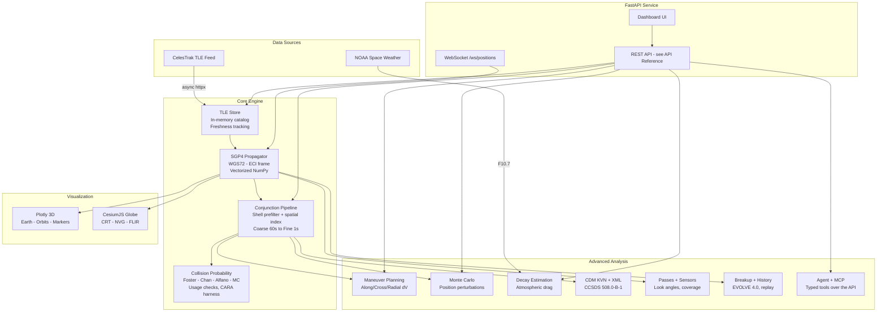

### Module Map

| Module | Purpose |
| ------ | ------- |
| `propagator.py` | SGP4 wrapper: `(jd, fr)` Julian date handling, ECI propagation, vectorized NumPy mode |
| `conjunction.py` | Two-phase detection pipeline, risk classification, event history |
| `probability.py` | 2D Pc: encounter-plane projection, Bessel I0 integration, TLE-age sigma scaling, full-covariance Foster/Chan/Monte-Carlo methods |
| `validation.py` | Cross-method Pc validation suite (`python -m sda.validation`) |
| `cara.py` | NASA CARA reference harness over the vendored CDMs and Alfano cases (`python -m sda.cara`) |
| `screening.py` | Shell prefilter, spatial index, vectorized catalog propagation, regime survey, formation exclusions, composite risk score |
| `tle_store.py` | In-memory TLE catalog, 2/3-line parser, freshness tracking |
| `maneuver.py` | Orbital elements extraction, along/cross/radial delta-V options |
| `montecarlo.py` | Gaussian position-noise miss-distance distributions |
| `decay.py` | Atmospheric density model, F10.7 scaling, lifetime estimation |
| `cdm.py` | CCSDS 508.0-B-1 CDM generation, KVN and XML parsing, and Pc from real covariances |
| `passes.py` / `sensors.py` | Observer look angles, pass prediction, sensor network, coverage, fences, DOP |
| `breakup.py` / `rv2tle.py` | NASA Standard Breakup Model, Gabbard data, state-vector to TLE fitter |
| `tle_history.py` / `replay.py` | Epoch-keyed TLE archive, maneuver detection, historical replay |
| `spacetrack.py` / `alerts.py` / `report.py` / `fleet.py` / `doctor.py` | Space-Track client, alert rules, PDF reports, fleet screening, self-check |
| `ratelimit.py` | Token-bucket limiter used by the API middleware |
| `llm.py` / `agent.py` / `mcp_server.py` | Provider chain, typed tool loop, MCP stdio server |
| `constants.py` | Shared WGS72 physical constants (matching SGP4 internals) |
| `visualization.py` | Plotly 3D Earth, orbit traces, screening volumes |
| `routes/` | FastAPI routers: satellites, conjunctions, analysis, system, worldview, pc, passes, history, ops, agent |
| `templates/` | Dashboard and CesiumJS WorldView HTML plus `static/` (SGP4 worker, styles, layers, PWA files) |
| `models.py` | Pydantic data models (TLERecord, StateVector, ConjunctionEvent, ...) |
| `api.py` | App assembly, lifespan, CelesTrak/NOAA background tasks |

---

## API Reference

The dashboard (`GET /`) and the globe (`GET /worldview`) are served as HTML outside the schema. The table below is generated by `python scripts/gen_api_table.py --write`; do not edit it by hand.

<!-- api-table:start -->
149 REST endpoints + 1 WebSocket, with auto-generated docs at **/docs** (Swagger UI) and **/redoc**.

| Method | Endpoint | Description |
| ------ | -------- | ----------- |
| `GET` | `/health` | Health check and system status |
| `GET` | `/metrics` | Performance and operational metrics |
| `GET` | `/space-weather` | Live space weather data from NOAA SWPC |
| `GET` | `/satellites` | List all tracked satellites |
| `DELETE` | `/satellites/{norad_id}` | Remove a satellite from tracking |
| `GET` | `/satellites/{norad_id}` | Get satellite detail with current state vector |
| `GET` | `/satellites/{norad_id}/decay` | Orbital decay and lifetime estimate |
| `POST` | `/tle` | Ingest TLE data |
| `GET` | `/tle/freshness` | TLE freshness report for all satellites |
| `POST` | `/tle/history/snapshot` | Archive element sets for later replay and maneuver detection |
| `GET` | `/tle/history/{norad_id}` | Archived element sets for one object |
| `GET` | `/tle/history/{norad_id}/maneuvers` | Detected maneuvers, decay anomalies and the orbit change log |
| `POST` | `/tle/refresh` | Refresh TLEs from live CelesTrak sources |
| `POST` | `/tle/refresh/spacetrack` | Refresh the catalog from Space-Track.org |
| `GET` | `/tle/stale` | List satellites with stale TLEs |
| `POST` | `/conjunctions` | Run conjunction analysis with collision probability |
| `POST` | `/conjunctions/cdm` | Generate CCSDS Conjunction Data Messages |
| `POST` | `/conjunctions/cdm/ingest` | Ingest a CCSDS CDM and compute Pc from its real covariances |
| `GET` | `/conjunctions/exclusions` | Bundled formation and co-orbiting exclusion table |
| `DELETE` | `/conjunctions/history` | Clear conjunction history |
| `GET` | `/conjunctions/history` | Historical conjunction events |
| `POST` | `/conjunctions/survey` | All-vs-all conjunction survey restricted to one orbit regime |
| `GET` | `/conjunctions/visualize` | Interactive 3D conjunction visualization with screening volumes |
| `POST` | `/maneuver` | Plan collision avoidance maneuver |
| `POST` | `/montecarlo` | Monte Carlo miss distance uncertainty analysis |
| `POST` | `/pc/cdm` | Compute Pc from a CDM in KVN or XML form |
| `POST` | `/pc/compare` | Compare every Pc method on one encounter |
| `POST` | `/pc/dilution` | Scan covariance scale for the maximum achievable Pc |
| `POST` | `/pc/max-missing-covariance` | Upper bound on Pc when one covariance is missing |
| `POST` | `/passes` | Predict ground-station passes |
| `GET` | `/sensors` | Bundled surveillance sensor network |
| `POST` | `/sensors/coverage` | Which sensors can see an object now |
| `POST` | `/sensors/fences` | Sensor fence crossings over a window |
| `POST` | `/lookangles` | Topocentric look angles at one instant |
| `POST` | `/dops` | Dilution of precision for an observer |
| `POST` | `/breakup/simulate` | Simulate a breakup with the NASA standard breakup model |
| `POST` | `/replay` | Replay the catalog at a past epoch |
| `GET` | `/reentries` | Predicted reentries from Space-Track TIP messages |
| `GET` | `/fleet/example` | Example fleet definition (YAML) |
| `POST` | `/fleet/screen` | Screen an operator fleet against the tracked catalog |
| `POST` | `/report` | Conjunction report as a self-contained HTML page or a PDF |
| `GET` | `/alerts/config` | Current alerting configuration |
| `POST` | `/alerts/config` | Replace the alerting configuration |
| `DELETE` | `/alerts/log` | Clear the alert log |
| `GET` | `/alerts/log` | Recently dispatched alerts |
| `POST` | `/alerts/test` | Send a synthetic alert to every webhook |
| `GET` | `/spacetrack/cdm` | Publicly released conjunction data messages from Space-Track |
| `GET` | `/doctor` | Environment diagnostics (offline) |
| `POST` | `/agent/chat` | Ask the orbital engine a question in natural language |
| `GET` | `/agent/health` | LLM provider chain status |
| `GET` | `/agent/tools` | Typed tool catalogue offered to the model |
| `GET` | `/api/ais` | AIS vessel positions in a bounding box (needs AISSTREAM_API_KEY) |
| `GET` | `/api/aurora` | NOAA SWPC OVATION aurora probability map, cells at or above a threshold |
| `GET` | `/api/aviation/aircraft/{hex_id}` | Aircraft card: registration, type, operator, route and LiveATC links |
| `GET` | `/api/aviation/emergencies` | Aircraft squawking 7500, 7600 or 7700 (adsb.lol) |
| `GET` | `/api/aviation/gps-interference` | GPS interference inferred from aircraft NIC and NACp per hex, last hour |
| `GET` | `/api/aviation/military` | Military aircraft from adsb.lol /v2/mil, cached to fit the request budget |
| `GET` | `/api/aviation/nearest-site` | Nearest mapped military site to a point (OpenStreetMap via Overpass) |
| `GET` | `/api/aviation/status` | adsb.lol request budget and refresh intervals for the aviation overlay |
| `GET` | `/api/bikeshare` | GBFS bikeshare stations and live availability |
| `GET` | `/api/buildings` | OpenStreetMap building footprints and heights in a small box |
| `GET` | `/api/cameras` | Public cameras inside a view (capped, evenly sampled) |
| `GET` | `/api/cameras/density` | Camera counts per grid cell inside a view |
| `GET` | `/api/cameras/nearest` | Cameras nearest a point, nearest first |
| `GET` | `/api/cameras/random` | One random camera |
| `GET` | `/api/cameras/search` | Cameras whose name or city contains the text |
| `GET` | `/api/cameras/summary` | What the public camera catalog holds |
| `GET` | `/api/cameras/{rid}` | One camera with its feed |
| `GET` | `/api/cameras/{rid}/snapshot` | Current snapshot of a TxDOT camera (JPEG) |
| `GET` | `/api/cctv` | Public traffic-camera locations and snapshot URLs |
| `GET` | `/api/config` | Optional map-provider tokens for the WorldView frontend |
| `GET` | `/api/conflict/acled` | Recent ACLED events (needs ACLED_EMAIL and ACLED_PASSWORD on the server) |
| `GET` | `/api/conflict/acled/{event_id}` | One ACLED event |
| `GET` | `/api/conflict/control/{theatre}` | Control of settlements in one theatre (Wikipedia detailed map) |
| `GET` | `/api/conflict/events` | Events verified against photo or video (GeoConfirmed), newest first |
| `GET` | `/api/conflict/events/{event_id}` | One verified event with its sources |
| `GET` | `/api/conflict/frontline/ukraine` | Russia-Ukraine areas of control and line of contact (DeepStateMap) |
| `GET` | `/api/conflict/frontline/ukraine/dates` | Days with a DeepStateMap update, oldest first |
| `GET` | `/api/conflict/history/density` | UCDP events per grid cell over a year range |
| `GET` | `/api/conflict/history/events` | The deadliest UCDP events inside a view |
| `GET` | `/api/conflict/history/summary` | What the UCDP history store holds |
| `GET` | `/api/conflict/history/years` | UCDP events and deaths per year |
| `GET` | `/api/conflict/history/{event_id}` | One UCDP event |
| `GET` | `/api/conflict/summary` | Conflict layer sources and their state |
| `POST` | `/api/conjunction-globe-data` | Conjunction events formatted for CesiumJS globe rendering |
| `POST` | `/api/conjunction-pc-history` | Pc evolution over lead times before TCA |
| `GET` | `/api/earthquakes` | Recent seismic activity from USGS |
| `GET` | `/api/eonet` | NASA EONET natural events, one point each (latest geometry) |
| `GET` | `/api/fires` | NASA FIRMS active fire detections (needs FIRMS_MAP_KEY) |
| `GET` | `/api/flights` | Live flight data from OpenSky Network |
| `GET` | `/api/gdelt` | Geolocated news events from the GDELT 2.0 event export, grouped by place |
| `GET` | `/api/geocode` | Place search via OpenStreetMap Nominatim |
| `GET` | `/api/geocode/reverse` | Place name for a point via OpenStreetMap Nominatim |
| `GET` | `/api/infra/cables` | Submarine cables as GeoJSON (TeleGeography) |
| `GET` | `/api/infra/cables/{cable_id}` | One cable: landing countries and how many other cables land in each |
| `GET` | `/api/infra/item/{uid}` | One infrastructure item with its fields, links and source |
| `GET` | `/api/infra/items` | Infrastructure inside a view, the limit shared across kinds |
| `GET` | `/api/infra/search` | Infrastructure by name or code, highest ranked first |
| `GET` | `/api/infra/summary` | What the infrastructure catalog holds |
| `GET` | `/api/intel/borders` | Simplified country polygons for the choropleth |
| `GET` | `/api/intel/convergence` | Cells where three or more event kinds meet within 24 hours |
| `GET` | `/api/intel/countries` | Every country with its label point and box |
| `GET` | `/api/intel/country-at` | The country under a point |
| `GET` | `/api/intel/country/{code}` | The country card |
| `GET` | `/api/intel/cyber` | Botnet C2 servers per country (abuse.ch Feodo Tracker) |
| `GET` | `/api/intel/exchanges` | Which major stock exchanges are in session now |
| `GET` | `/api/intel/instability` | This application's instability heuristic for every country |
| `GET` | `/api/intel/outages` | IODA internet outage alerts per country, 24 h |
| `GET` | `/api/intel/outbreaks` | WHO Disease Outbreak News at affected countries |
| `GET` | `/api/intel/summary` | Country intel sources, attribution and formula |
| `GET` | `/api/launches` | Upcoming orbital launches from Launch Library 2 |
| `GET` | `/api/maritime/chokepoints` | Chokepoint monitors: polygons, vessels inside now, transits |
| `GET` | `/api/maritime/chokepoints/{cp_id}` | Vessels inside one chokepoint monitor now |
| `GET` | `/api/maritime/vessels` | Vessels in a box with sanctions flags, plus dark-ship estimates |
| `GET` | `/api/military-flights` | Live military aircraft from crowdsourced ADS-B (adsb.lol) |
| `GET` | `/api/military-sites` | Military installations in a bounding box from OpenStreetMap |
| `GET` | `/api/orbitviz/attributes` | SATCAT attributes of every object on orbit, packed |
| `GET` | `/api/orbitviz/debris` | Fragmentation events and their pieces still on orbit |
| `GET` | `/api/orbitviz/history` | Objects in orbit by year, from SATCAT launch and decay dates |
| `POST` | `/api/orbitviz/visible` | Brightest visible passes over an observer |
| `GET` | `/api/peaks` | Peaks inside a view, most prominent first |
| `GET` | `/api/peaks/density` | Peak counts per grid cell, with the highest peak in each |
| `GET` | `/api/peaks/nearest` | Peaks nearest a point, nearest first |
| `GET` | `/api/peaks/search` | Named peaks whose name starts with the text, most prominent first |
| `GET` | `/api/peaks/summary` | What the worldwide peak catalog holds |
| `GET` | `/api/peaks/{peak_id}` | One peak with its sources |
| `GET` | `/api/radio` | Internet radio stations near a point (Radio Browser) |
| `GET` | `/api/sanctions/aircraft` | Is an aircraft listed? By tail number, Mode S code or serial |
| `GET` | `/api/sanctions/index` | Every match key of one kind |
| `GET` | `/api/sanctions/summary` | What the cached sanctions lists hold |
| `GET` | `/api/sanctions/vessel` | Is a vessel listed? By IMO number or MMSI |
| `GET` | `/api/satcat/facets` | Satcat Facets |
| `GET` | `/api/satcat/ids` | Satcat Ids |
| `GET` | `/api/satcat/status` | Satcat Status |
| `GET` | `/api/satcat/{norad_id}` | Satcat Card |
| `GET` | `/api/satellite-orbits` | Orbit paths for all tracked satellites |
| `GET` | `/api/satellite-positions` | All satellite positions as lat/lon/alt |
| `GET` | `/api/search` | Universal search: coordinates, satellites, aircraft, cameras, peaks, places |
| `GET` | `/api/space-weather` | NOAA SWPC planetary K index, solar wind and active alerts |
| `GET` | `/api/space-weather/conjunction` | Geomagnetic storm warning for a conjunction's TCA and the two perigees |
| `GET` | `/api/space-weather/summary` | NOAA SWPC Kp, G/S/R scales, observed F10.7 and the 45-day Ap and F10.7 forecast |
| `GET` | `/api/summit/conditions` | Summit Conditions |
| `POST` | `/api/summit/verdicts` | Summit Verdicts |
| `GET` | `/api/tles` | Raw TLE catalog for client-side propagation |
| `GET` | `/api/traffic` | Road geometry in a bounding box from OpenStreetMap Overpass |
| `GET` | `/api/volcanoes` | Holocene volcanoes from the Smithsonian Global Volcanism Program |
| `GET` | `/api/weather-alerts` | Active National Weather Service alerts (United States) |
| `GET` | `/api/weather/cyclones` | Active tropical cyclones: NOAA NHC (with track and cone) and GDACS (all basins) |
| `GET` | `/api/weather/wind` | Global 10 m wind u/v on a 5-degree grid for the current hour (Open-Meteo) |
| `WS` | `/ws/positions` | WebSocket stream |
<!-- api-table:end -->

---

## Risk Classification

| Miss Distance | Relative Velocity | Risk Level |
| :---: | :---: | :---: |
| < 0.5 km | any | **CRITICAL** |
| < 1.0 km | any | **HIGH** |
| < 5.0 km | > 10 km/s | **HIGH** |
| < 5.0 km | <= 10 km/s | **MODERATE** |
| < 10.0 km | any | **LOW** |
| >= 10.0 km | any | **NEGLIGIBLE** |

---

## Collision Probability

2D short-term-encounter method in the tradition of Foster & Estes (1992), Chan (2008), and Alfano (2005):

1. Project the miss vector onto the encounter plane (perpendicular to relative velocity)
2. Combine per-object position covariances: sigma = sqrt(sigma1^2 + sigma2^2)
3. Integrate the 2D Gaussian over the circular hard-body cross-section (default combined radius 20 m)
4. Radial integration uses the modified Bessel function I0 (Abramowitz & Stegun 9.8.1-2)

**Covariance model:** TLEs carry no covariance, so an isotropic synthetic sigma is used, scaled with TLE epoch age following Vallado (2013, Ch. 9): 50 m for a fresh TLE, growing to ~500 m at 3 days. Note the well-known *probability dilution* property of 2D Pc: for very stale data, larger sigma can decrease reported Pc; miss distance and risk level are therefore always reported alongside Pc.

**Full-covariance path:** when real covariances are available, e.g. from an ingested CCSDS CDM (`POST /conjunctions/cdm/ingest`), Pc is computed from the actual 3x3 per-object RTN covariances instead of the synthetic sigma. Each covariance is rotated to ECI via its object's own state, combined, projected onto the encounter plane, and evaluated with independent methods that are reported side by side: Foster 2D quadrature (adaptive polar grid), the Alfano 2005 erf-strip series with adaptive Simpson intervals and convergence metadata, the Chan analytic series in a cancellation-free summation order that stays accurate into the deep tail (Pc ~ 1e-16), and 2D Monte Carlo. `POST /pc/compare` returns all of them for one encounter.

**Usage checks:** every full-covariance result carries a `PcUsageReport` with coded warnings in the style of CARA's `PcMultiStep`: `LOW_RELATIVE_VELOCITY`, `EXTENDED_ENCOUNTER`, `NPD_COVARIANCE`, `ILL_CONDITIONED_COVARIANCE`, `EXTREME_ASPECT_RATIO`, `CHAN_ASPECT_RATIO`, `HBR_COMPARABLE_TO_MISS` and `PC_DILUTION`. Non-positive-definite covariances are remediated with CARA's clip ladder before use and flagged. `POST /pc/max-missing-covariance` (Frisbee) and `POST /pc/dilution` bound the Pc when one covariance is missing or the data are stale.

**Chan validity:** the Chan series is exact only for isotropic covariances. Measured against the CARA reference set its error grows with the encounter-plane aspect ratio (3% at up to 10:1, near 100% above 100:1), so Foster or Alfano is the reported value and Chan is a cross-check; the `CHAN_ASPECT_RATIO` warning fires when the reduction error estimate exceeds 5%.

---

## Validation & Accuracy

- **Propagation** delegates to [python-sgp4](https://github.com/brandon-rhodes/python-sgp4), which is verified against the official Vallado et al. (2006) reference implementation of SGP4 (agreement to ~0.1 mm). This project pins the **WGS72** gravity model and the `(jd, fr)` split Julian-date convention throughout; shared constants in `constants.py` match `sgp4`'s internal WGS72 values exactly.
- **Frames:** all positions/velocities are ECI (TEME) in km and km/s. Geodetic conversion (WGS84 ellipsoid) is used only for map display, never in conjunction math.
- **Pc cross-method validation:** every Pc implementation shipped by this package is validated against mathematically independent references by `python -m sda.validation` (also a CI gate, with a non-zero exit on any failure). Four computation approaches are compared across 11 scenarios spanning isotropic and anisotropic (up to 10:1 aspect, rotated) covariances and miss distances from 0 to 8 sigma: closed-form solutions, the Chan analytic series (exact for isotropic encounters), Foster 2D quadrature, and Monte Carlo sampling. Measured agreement (this release):

  | Comparison | Regime | Max relative error |
  | ---------- | ------ | ------------------ |
  | Foster quadrature vs. exact series | isotropic, Pc 1e-1 to 1e-16 | 3.7e-6 |
  | Legacy pipeline Pc vs. exact series | isotropic | 1.6e-7 |
  | Foster standard vs. high-resolution grid | anisotropic to 10:1 | 1.6e-6 |
  | Monte Carlo (4e6 samples) vs. reference | Pc >= 1e-5 | within 5 standard errors |
  | Chan series vs. Foster | anisotropic (documented approximation) | 0.2% at 3:1, 13% at 10:1 |

  The Chan anisotropic error is the known equivalent-area approximation error and is why Foster is the primary reported value.
- **NASA CARA reference harness:** `python -m sda.cara` (a CI job) re-propagates 53 CARA CDMs and the 11 Alfano 2009 test cases from the vendored `tests/data/cara/` set (NASA Open Source Agreement 1.3, notice alongside) and compares every method with CARA's own Pc2D and Pc3D outputs. Current result: Foster inside CARA's tolerance band on 53 of 53 cases, Alfano within 5.4e-5 on 11 of 11 literals; the 34 adversarial sample CDMs are kept as strict expected failures that document where 2D Pc is not applicable.
- **Test suite:** 1,550+ offline-deterministic tests covering LEO propagation bounds, Julian-date roundtrips, all risk-classification branches, Pc bounds and Bessel accuracy, cross-method Pc agreement, CDM round-trip parsing, maneuver physics, and every API endpoint via TestClient.

### Benchmark

Measured output of `make benchmark` (Python 3.13, Windows 11, Ryzen-class laptop CPU):

```text
ISS orbit propagation: 1441 steps (24h @ 60s)
  Loop mode:           4.9 ms avg  (4.1 ms best)
  Vectorized mode:     2.0 ms avg  (1.8 ms best)
  Speedup:         2.5x

Fine propagation: 601 steps (10 min @ 1s)
  Loop mode:           1.6 ms avg
  Vectorized mode:     0.7 ms avg
  Speedup:         2.2x

Screening 2 satellites (1 pairs) over 24h:
  Total propagation: 3.4 ms
  Per satellite:     1.7 ms
```

Run `make benchmark` to reproduce on your hardware.

---

## Disclaimer

This tool is for **research and education**. It must not be used as a sole source of truth for operational collision-avoidance decisions:

- TLE-based screening carries **km-level position uncertainty** that grows with TLE age (roughly 1-3 km/day for LEO).
- TLEs provide no covariance; the Pc covariance here is a synthetic empirical model.
- The atmospheric decay and maneuver models are simplified first-order approximations.

Operational conjunction assessment uses owner/operator ephemerides, calibrated covariances, and validated tools (e.g., NASA CARA). See [SECURITY.md](SECURITY.md) for the safety-critical component list.

---

## Testing

```bash
pytest tests/ -x --tb=short          # Fast, fail-first
pytest tests/ --cov=src/sda          # With coverage
make lint                            # ruff + mypy
```

| Module | Coverage Target |
| ------ | --------------- |
| propagator | 90% |
| tle_store | 90% |
| conjunction | 85% |
| probability | 85% |
| api | 80% |
| maneuver / decay / montecarlo | 80% |

---

## Deployment

Kubernetes manifests live in `deploy/` (see `deploy/README.md`). Set `SDA_HOST=0.0.0.0` in containers; the default bind is loopback.

```bash
# Railway
railway login && railway init && railway up

# Fly.io
fly launch && fly deploy
```

The `Dockerfile` includes a container health check. No environment variables are required; the app starts with a bundled demo catalog and seeds live CelesTrak data in the background.

---

## Tech Stack

| Component | Library | Purpose |
| --------- | ------- | ------- |
| Propagation | **sgp4** | NORAD SGP4/SDP4 (WGS72 gravity) |
| Numerics | **NumPy** | Vectorized orbital computations |
| API | **FastAPI** + **Uvicorn** | Async REST + WebSocket |
| Validation | **Pydantic** | Data models + serialization |
| HTTP Client | **httpx** | Async CelesTrak/NOAA integration |
| 3D Viz | **Plotly** | Interactive orbit visualization |
| Globe | **CesiumJS** (CDN) | WorldView globe, worker-side SGP4 via satellite.js |
| Optional | **scipy** (`[screening]`), **fpdf2** (`[reports]`) | KD-tree screening index, PDF reports; both degrade cleanly when absent |

---

## References

- D. Vallado, P. Crawford, R. Hujsak, T.S. Kelso, "Revisiting Spacetrack Report #3," *AIAA/AAS Astrodynamics Specialist Conference*, 2006 (AIAA 2006-6753).
- S. Alfano, "A Numerical Implementation of Spherical Object Collision Probability," *Journal of the Astronautical Sciences*, Vol. 53, No. 1, 2005.
- J.L. Foster and H.S. Estes, "A Parametric Analysis of Orbital Debris Collision Probability and Maneuver Rate for Space Vehicles," NASA JSC-25898, 1992.
- F.K. Chan, *Spacecraft Collision Probability*, The Aerospace Press, 2008.
- D. Vallado, *Fundamentals of Astrodynamics and Applications*, 4th Ed., Microcosm Press, 2013.
- M. Abramowitz & I. Stegun, *Handbook of Mathematical Functions*, Dover, 1965. Section 9.8 (Bessel functions).
- CCSDS 508.0-B-1, *Conjunction Data Message*, Recommended Standard, 2013.
- S. Alfano, "Satellite Conjunction Monte Carlo Analysis," *AAS 09-233*, 2009 (the 11 reference test cases).
- N.L. Johnson, P.H. Krisko, J.-C. Liou, P.D. Anz-Meador, "NASA's New Breakup Model of EVOLVE 4.0," *Advances in Space Research*, Vol. 28, No. 9, 2001.
- M.D. Hejduk and D.E. Snow, "The Effect of Neglecting Covariance Realism on Conjunction Assessment," AAS/AIAA Astrodynamics Specialist Conference, 2018 (covariance realism scaling).
- NASA CARA Analysis Tools, https://github.com/nasa/CARA_Analysis_Tools (NASA Open Source Agreement 1.3; reference data vendored in `tests/data/cara/`).

## Attribution

Parts of this project were adapted from open-source references, each credited in the module docstring: satguard (MIT) for the screening design and covariance realism helpers, orbveil (Apache-2.0) for the CDM XML structure and the exclusion-table design, satvis (MIT) for the worker propagation and PWA setup and gods-eye-view (MIT) for the globe post-processing and camera modes. AGPL and unlicensed projects surveyed in `reference/COMPARISON.md` were used as design references only; no code was copied from them.

## Citing

If you use this software in research, see [CITATION.cff](CITATION.cff) or use GitHub's "Cite this repository" button.

---

## Contributing

See [CONTRIBUTING.md](CONTRIBUTING.md) for development setup, coding standards, and PR guidelines. This project follows the [Contributor Covenant Code of Conduct](CODE_OF_CONDUCT.md). Security policy: [SECURITY.md](SECURITY.md).

---

## License

[MIT](LICENSE)
